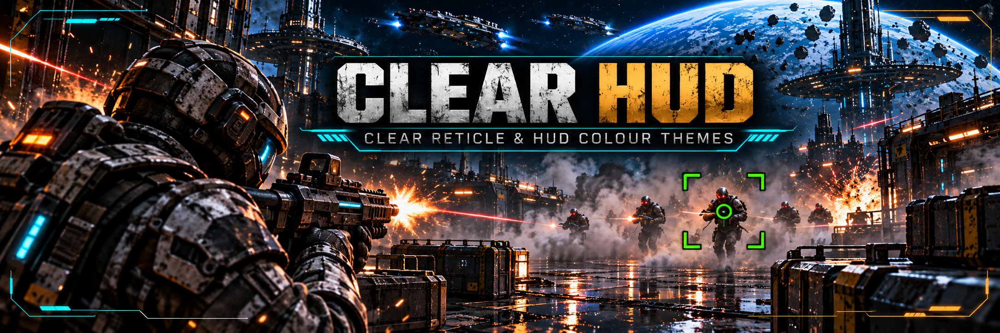
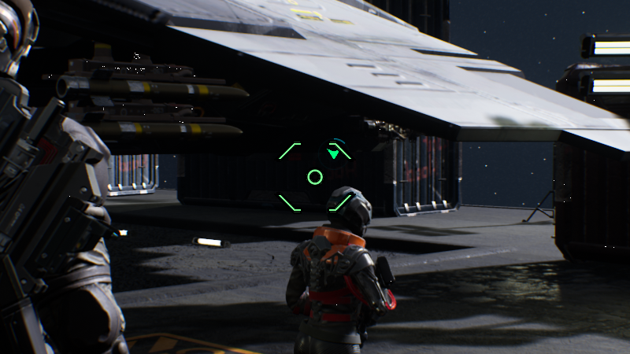
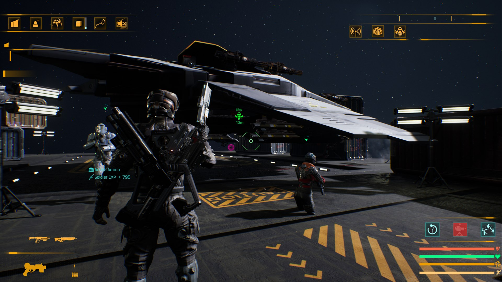

# Clear HUD — a reticle you can see, and HUD colours for SpaceBourne 2

On foot, SpaceBourne 2's reticle is thin, light grey and has no outline: on snow, sand, a bright
sky or a busy station you lose it. Clear HUD gives it a strong colour, a dark outline and a bigger
size, lets you change the HUD's cyan for another colour, and can hide the damage numbers on foot.

Version 0.1.5 · [Nexus Mods page](https://www.nexusmods.com/spacebourne2/mods/16) · UE4SS Lua mod · works alone or with the rest of the
realism set (see below). Asked for by players on the DBK Games Discord.

## What it does

- **A reticle you can see:** green by default, full opacity, 25% bigger, with a dark outline that
  keeps it readable on any background. It still reacts to moving, firing and aiming like the
  game's own.
- **Your colour and shape:** seven colour presets or your own colour, opacity, size, outline or
  drop shadow, and any of the game's 11 reticle shapes.
- **HUD colour themes:** amber, green, red, blue, purple or white instead of the game's cyan, or
  your own colour. Health, warnings and other colours stay as they are. Off by default.
- **One reticle:** on foot the game's own small ring in the middle is hidden, so it doesn't sit on
  top of Clear HUD's reticle.
- **A cleaner screen:** the damage numbers on foot are hidden, both kinds: the ones by the enemy
  bar and the ones that float up from the hit, red on a headshot (the game's own "Damage Text"
  option only covers ships in space), and so is the enemy bar at the top. The markers on foot can
  be hidden too. All in the settings, with an optional key to flip them while you play.
- **Light:** applied when the game builds the reticle or the HUD, never every frame.
- **On by default.** Install it and the reticle is clear, with no damage numbers or enemy bar.

## What the game's own settings already do

Settings → Interface has no reticle, HUD colour or enemy-marker options. What it has:

- **Damage Text**: damage numbers over enemy ships in space (off by default). It does not cover
  the numbers on foot; Clear HUD's `HideDamageNumbers` does.
- **Indicators Text Scale**: size of the text on the HUD markers.
- **Show Weapons Heat At Crosshair**, **Static Game HUD**, **Show Telemetry / Bottom Ship Status
  Only When Weapons Are Online**, **Disable Weapon Activation HUD Effect**: ship HUD options.
- **Display Keybinds**: never, gamepad only or always.

## Requirements

- SpaceBourne 2 (Steam).
- [UE4SS 3.0.1](https://github.com/UE4SS-RE/RE-UE4SS/releases/tag/v3.0.1), a free script loader
  for Unreal Engine games. Installing HTR or the realism set installer installs it too.

## Install

Option A (recommended): the [SpaceBourne 2 Realism installer](https://www.nexusmods.com/spacebourne2/mods/11).

Option B, manual:

1. Download `ClearHUD-0.1.5.zip` from the
   [releases](https://github.com/hubertdungen/SpaceBourne2-ClearHUD/releases).
2. Extract it into the game folder (`...\steamapps\common\SpaceBourne 2\`). It adds
   `SB2\Binaries\Win64\Mods\ClearHUD\`; the `enabled.txt` inside turns it on.
3. Load a game and draw a weapon.

Uninstall: delete `SB2\Binaries\Win64\Mods\ClearHUD`. The mod never writes to your saves.

## Controls

None needed. Optional: set `ToggleKey` to hide or show the damage numbers, the target bar and the
markers on foot while you play; a short message confirms each press.

## Settings

Edit `Mods\ClearHUD\scripts\config.lua`, then restart the game. Every line is optional.

- `Enabled`: `false` switches the mod off completely.
- `Reticle.Preset`: `"Green"`, `"Yellow"`, `"Orange"`, `"Red"`, `"Magenta"`, `"Cyan"`, `"White"`,
  `"Game"` (keeps the grey) or `"Custom"` (uses `Reticle.Color`).
- `Reticle.Opacity` (1.0), `Reticle.Size` (1.25; 1.0 is the game's size).
- `Reticle.Outline`: `"Outline"`, `"Shadow"` or `"Off"`; `OutlineColor`, `OutlineOpacity` (0.9),
  `OutlineWidth` (1.5 pixels).
- `Reticle.Style`: `0` keeps the weapon's reticle (shape 6); `1` to `11` picks one of the game's
  shapes.
- `Reticle.HideGameRing`: hide the game's small ring in the middle on foot (`true`).
- `Reticle.Enabled`: `false` leaves the reticle as the game makes it.
- `Theme.Preset`: `"Game"` (cyan, no change), `"Amber"`, `"Green"`, `"Red"`, `"Blue"`, `"Purple"`,
  `"White"` or `"Custom"` (uses `Theme.Color`).
- `HideDamageNumbers`: hide the damage numbers on foot, by the enemy bar and floating at the hit
  (`true`).
- `HideTargetBar`: hide the bar at the top with the name, level and health of the enemy you hit
  (`true`).
- `HideMarkersOnFoot`: hide **all** the game's markers on foot: the red enemy markers and arrows,
  and also mission, place and door markers (`false`). The game has one switch for all of them.
- `ToggleKey`: none by default (`""`). Any key the game and the realism set don't use, with or
  without `Shift+`; the others are refused.

Colours are `{ red, green, blue }` from 0 to 1, for example `{ 1.0, 0.8, 0.0 }`.

## How it works

When a weapon adds the reticle, Clear HUD sets its colour, opacity and size, and puts black copies
of the same reticle right behind it, a pixel or two to each side, as the outline. The copies get
the same movement, recoil and zoom animations, so they stay in place. The theme swaps the HUD's
cyan once, when the HUD is built. Nothing runs every frame but a timer check on the game's own
ticks (no UE4SS background loops, which can crash UE4SS when several mods use them). Details:
[DESIGN.md](https://github.com/hubertdungen/SpaceBourne2-ClearHUD/blob/main/DESIGN.md).

## Status and known limits

<!-- nexus:skip -->
0.1.5 only turns two defaults on (`HideDamageNumbers`, `HideTargetBar`); the code paths are the
ones tested below with both set to true.

0.1.4, tested in game on 2026-11-08 (same save, all set mods incl. Tactical First Person and Bigger
Armies): the reticle outline built once, from the game's tick, and the crosshair kept the same 5
widgets over 8 weapon swaps and after a forced garbage collection; a floating damage number built
the game's way (the enemy's `WB_SpecialHitPoint`) was collapsed as it was built with
`HideDamageNumbers` on, and on screen with it off; frame time 9.8–9.9 ms on average. Not seen in a
real fight yet: a floating number from a hit on an elite (the elites the test spawned took no
damage).

0.1.2, tested in game on 2026-11-06 (same save, all set mods incl. Tactical First Person and Bigger
Armies): in a fight the game put the target bar up for 205 frames and it was on screen in none of
them; shown again with the key, it is back. Both fallbacks seen with their hooks made to fail: the
theme applied from the half-second check, the reticle applied again within a second. From the same
day's 0.1.1 tests: with the Amber theme all HUD text stays visible (missions, squad, weapon, ammo);
markers on foot hidden (the red enemy arrows and the green squad marker) and shown again; damage
numbers hidden on a hit; the game's centre ring gone on foot, so only one reticle; frame time about
10 ms on average on foot with enemies; saves untouched.

Tested in game on 2026-11-01 (station, pretest save, with HTR, Split Controls, Silent Ops, Gear
Without Levels, Faction Power, Tactical Engineering, Ammo Discipline, Get Out of the Way and Ground
Waypoints installed):
- the reticle with colour, size 1.25 and outline on a pistol; the outline built for all 11 of the
  game's reticle shapes (1–4 ms each, once per shape change), and it follows the reticle;
- the Amber theme: 418 colours in 2032 HUD widgets changed once, in 0.56 s during the level load;
- frame times with the mod on, standing in the station: 9.6–9.7 ms average, no frame over 30 ms,
  no hitch over 100 ms (the same spot measured 9.3–9.9 ms in earlier tests without it);
- your saves untouched.
Not yet seen in game: the optional key's message. A first build that also hid the on-foot enemy markers
crashed the game at the main menu (a UE4SS hook on a native engine function); that feature was
removed and the crash did not come back.
<!-- /nexus:skip -->

Known limits:

- **On foot only** for the reticle. Ship reticles are the game's own.
- **Enemy markers alone** cannot be hidden: the game draws them with the other markers, behind one
  switch. `HideMarkersOnFoot` hides them all (Ground Waypoints' markers too).
- **Theme**: parts the game draws straight on screen (markers, ship HUD lines) and icons whose
  colour is baked into the picture keep their colours. Panels the game rebuilds while you play
  (for example new list entries) may come back cyan until the next load. With a theme on, the
  first load of a game pauses about half a second longer.
- **Tactical First Person** hides the reticle in first person by default; set its `Crosshair` to
  `"Game"` to keep Clear HUD's reticle there.

## Part of the SpaceBourne 2 realism set

Part of the realism set, built around [Hardcore Tactical Realism](https://www.nexusmods.com/spacebourne2/mods/4)
as the core mod. HTR is not required: this mod works on its own or with any of the others.
To install them all at once, use the installer:
[SpaceBourne 2 Realism](https://github.com/hubertdungen/SpaceBourne2-Realism)
([Nexus](https://www.nexusmods.com/spacebourne2/mods/11)).

| Mod | Status |
|---|---|
| **Hardcore Tactical Realism (HTR)** — realistic ballistics and tactical AI | released: [GitHub](https://github.com/hubertdungen/SpaceBourne2-HardcoreTacticalRealism) · [Nexus Mods](https://www.nexusmods.com/spacebourne2/mods/4) · [Steam discussion](https://steamcommunity.com/app/1646850/discussions/0/573805072991123580) |
| **Split Controls** — separate invert for ship and on foot | released: [GitHub](https://github.com/hubertdungen/SpaceBourne2-SplitControls) · [Nexus Mods](https://www.nexusmods.com/spacebourne2/mods/5) |
| **Silent Ops** — realistic stealth | released: [GitHub](https://github.com/hubertdungen/SpaceBourne2-SilentOps) · [Nexus Mods](https://www.nexusmods.com/spacebourne2/mods/6) |
| **Gear Without Levels** — use gear regardless of level | released: [GitHub](https://github.com/hubertdungen/SpaceBourne2-GearWithoutLevels) · [Nexus Mods](https://www.nexusmods.com/spacebourne2/mods/7) |
| **SB2 HOTAS** — HOTAS, triple screens, head tracking | released: [GitHub](https://github.com/hubertdungen/SpaceBourne2-HOTAS) · [Nexus Mods](https://www.nexusmods.com/spacebourne2/mods/8) |
| **Faction Power** — your deeds earn your faction power | released: [GitHub](https://github.com/hubertdungen/SpaceBourne2-FactionPower) · [Nexus Mods](https://www.nexusmods.com/spacebourne2/mods/9) |
| **Tactical Engineering** — realistic deployable turrets | released: [GitHub](https://github.com/hubertdungen/SpaceBourne2-TacticalEngineering) · [Nexus Mods](https://www.nexusmods.com/spacebourne2/mods/10) |
| **Ammo Discipline** — realistic ammo limits and scavenging | released: [GitHub](https://github.com/hubertdungen/SpaceBourne2-AmmoDiscipline) · [Nexus Mods](https://www.nexusmods.com/spacebourne2/mods/12) |
| **Ground Waypoints** — planet markers on foot and on the hoverbike | released: [GitHub](https://github.com/hubertdungen/SpaceBourne2-GroundWaypoints) · [Nexus Mods](https://www.nexusmods.com/spacebourne2/mods/13) |
| **Get Out of the Way** — NPCs step aside naturally | released: [GitHub](https://github.com/hubertdungen/SpaceBourne2-GetOutOfTheWay) · [Nexus Mods](https://www.nexusmods.com/spacebourne2/mods/14) |
| **Tactical First Person** — play on foot in first person | released: [GitHub](https://github.com/hubertdungen/SpaceBourne2-TacticalFirstPerson) · [Nexus Mods](https://www.nexusmods.com/spacebourne2/mods/15) |
| **Clear HUD** — a reticle you can see, HUD colours (this mod) | released: [GitHub](https://github.com/hubertdungen/SpaceBourne2-ClearHUD) · [Nexus Mods](https://www.nexusmods.com/spacebourne2/mods/16) |

## License

MIT. See [LICENSE](https://github.com/hubertdungen/SpaceBourne2-ClearHUD/blob/main/LICENSE).
